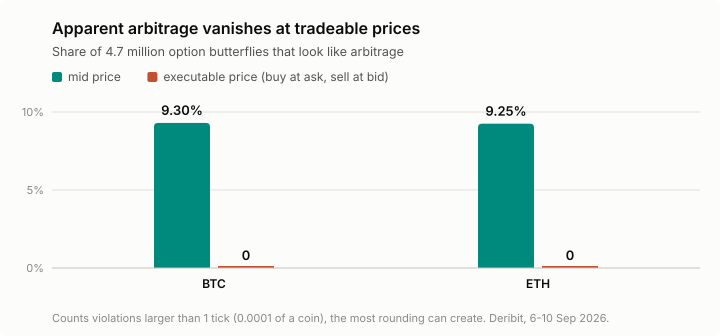
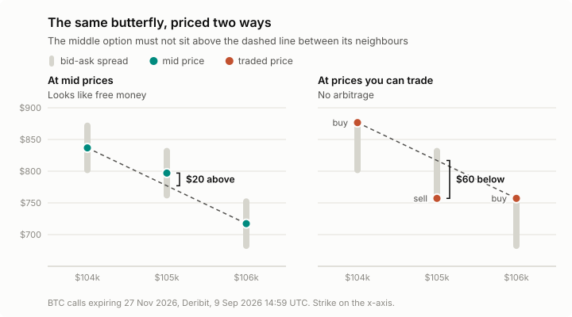

# Investigating crypto options arbitrage

Option prices have to follow a few rules that come from arbitrage alone, with no pricing model involved. Quoted prices on Deribit seem to break them all the time, so I recorded 3.5 days of BTC and ETH option books to see why none of it can actually be traded. About 1 in 11 butterflies look like free money at mid prices, but none survive once you buy at the ask and sell at the bid.

<picture>
  <source media="(prefers-color-scheme: dark)" srcset="docs/figures/violation-rates-dark.svg">
  
</picture>

## Parts

- A recorder that saves the full BTC and ETH option books from Deribit's public API every 60 seconds
- 5.3 million quotes stored as Parquet and queried with DuckDB
- An implied vol solver (Black-76, Newton's method with a bisection fallback). Median gap to Deribit's own vols: 0.09 vol points on BTC, 0.16 on ETH
- An arbitrage check on every butterfly, plus a linear program per expiry that checks all the quotes together

## Method

A butterfly is three options with the same expiry at neighbouring strikes. The middle option's price can never sit above the straight line joining its two neighbours. If it does, you sell the middle, buy the outside two, and lock in a profit.

```math
C(K_2) \le \lambda\, C(K_1) + (1-\lambda)\, C(K_3), \qquad K_2 = \lambda K_1 + (1-\lambda) K_3
```

I ran this check on two sets of prices:

- **Mid:** halfway between bid and ask
- **Executable:** the ask when buying, the bid when selling

A violation counts if it's bigger than one tick (0.0001 of a coin, about $8 on BTC).

Looking at three strikes at a time can miss problems spread across many, so for each expiry I also solved a linear program (SciPy / HiGHS) to see whether a single arbitrage-free set of prices fits inside every quoted spread at once.

I wrote down what I expected to find before looking at the data ([ADR 0006](docs/adr/0006-metrics-pre-registered.md)).

<picture>
  <source media="(prefers-color-scheme: dark)" srcset="docs/figures/butterfly-dark.svg">
  
</picture>

## Results

6,194 snapshots, 6 to 10 September 2026.

| | Butterflies | Arbitrage at mid | Arbitrage at executable |
|---|---|---|---|
| BTC | 2,516,346 | 233,926 (9.30%) | 0 |
| ETH | 2,149,426 | 198,883 (9.25%) | 0 |

- All 432,809 mid-price violations disappear at executable prices
- A typical one would only become real if you could trade 96% of the way from the bid or ask to the mid, on all three options at once
- An arbitrage-free surface fit inside the quoted spreads for all 68,627 expiry slices
- The only executable violations were 120 across expiries, where a longer-dated option was priced below a shorter-dated one. 107 of them came in one eight-minute window on 8 September and none lasted more than three minutes. Likely stale quotes

Takeway: if you backtest on mid prices, you'll find arbitrage that was never there.

## Limitations

- Top of book only, so I can't say how much size any violation was good for
- No fees or margin
- Arbitrage across exchanges isn't considered

## Running it

Requires Python 3.13.

```
pip install -e ".[dev]"
pytest                    # 132 tests
python record.py          # record snapshots every 60s
python load.py            # raw snapshots -> Parquet
python analyse.py         # results tables
```

Raw data isn't committed (about 105 MB per day). Design decisions are in [docs/adr](docs/adr/).
